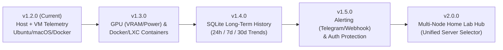

# PulseMonitor · 项目总结与演进路线图 (Project Summary & Roadmap)

> **当前版本**：`v1.2.0`  
> **本地项目路径**：`/Users/jichundong/.gemini/antigravity/scratch/sys-monitor-dashboard`  
> **GitHub 仓库**：`https://github.com/ejicdon/pulsemonitor.git`

---

## 一、 已完成的核心工作 (Completed Work)

### 1. 全栈实时硬件与系统监控面板 (`v1.0.0`)

- **高性能异步后端 (`app.py`)**
  - 基于 **FastAPI + psutil + WebSocket** 构建，内置后台 1 秒级环形历史缓冲池（`metrics_history`，保存最近 120 个采样点）。
  - 打开或刷新网页时通过 `/api/history` 接口立即填充历史趋势图表，无需从空白等待。
  - WebSocket 实时流 (`/ws/metrics`) 支持前端动态切换采样周期（`0.5s` / `1.0s` / `2.0s` / `5.0s`）以及一键暂停/恢复图表刷新。

- **暗色毛玻璃风格 Web UI (`static/index.html`, `static/style.css`, `static/app.js`)**
  - **顶部系统概览栏**：显示主机名、操作系统版本、CPU 品牌型号、系统运行时长（Uptime）、`1m / 5m / 15m` 平均负载（Load Avg）、电源/电池状态与 CPU 温度（`°C`）。
  - **四大实时 KPI 卡片**：
    - **CPU Utilization**：总使用率、物理/逻辑核心数、用户态/内核态/空闲占比。
    - **Physical Memory (RAM)**：已用/总容量、`Available` 可用空间与 `Swap` 交换区占用。
    - **Disk I/O Throughput**：实时读写总速率、IOPS 以及主分区容量进度条。
    - **Network Throughput**：实时下载（`↓`）/上传（`↑`）速率、累计收发流量及主网卡 IP。
  - **三条实时历史趋势曲线 (Chart.js)**：
    - CPU & 内存使用率历史趋势曲线（0–100% 双轴面积图）
    - 网络上下行带宽实时趋势曲线（自适应 `KB/s` 与 `MB/s`）
    - 磁盘读写吞吐实时趋势曲线
  - **硬件细粒度视图**：
    - **Per-Core CPU Load**：多核独立实时进度条与高负载变色预警（`<60%` 蓝、`60-85%` 橙、`>85%` 红）。
    - **Memory Allocation**：展示 `Wired/Buffers`、`Active`、`Cached/Inactive` 与 `Available` 内存分布条。
    - **Storage Volumes & Active NICs**：挂载分区容量详情与活跃 IPv4 网卡列表。
    - **Top 8 Active Processes**：按实时 CPU 占用率排序的活跃进程表。

---

### 2. macOS 原生菜单栏与程序坞应用 (`PulseMonitor.app`)

- **原生 Swift 客户端 (`macos_app/PulseMonitorApp.swift` & `macos_app/build_app.sh`)**
  - 使用 macOS 原生 `Cocoa` (`NSStatusBar`) + `WebKit` (`WKWebView`) 编写并编译为独立应用包 `PulseMonitor.app`（同步安装至 `~/Applications/PulseMonitor.app`），内置自绘高清脉冲图标 `AppIcon.icns`。
  - **顶部状态栏 (Menu Bar)**：常驻显示实时 `⚡ CPU% · RAM%`（每 2 秒自动刷新），下拉菜单支持查看实时下载网速，并可一键打开主窗口、在浏览器打开、重启或停止后台 `run.sh` 服务。
  - **底部程序坞 (Dock)**：点击图标时自动检测 `127.0.0.1:8788` 是否在线；若未启动则自动静默拉起 `run.sh` 并弹出原生桌面监控大屏。

---

### 3. Ubuntu / Linux Home Lab 跨平台适配与多形态安装包 (`v1.1.0`)

- **Linux 服务器深度适配**
  - 从 `/proc/cpuinfo` 自动解析服务器处理器型号（Xeon / EPYC / Core / ARM），从 `/etc/os-release` 识别发行版信息。
  - 读取 Linux CPU 硬件温度传感器（`coretemp`、`k10temp`、`cpu_thermal`）。
  - 自动过滤 Linux `squashfs`（snap 挂载）、`overlay`（Docker 层）、`tmpfs`、`/dev/loop*` 等虚拟挂载点噪音，仅展示真实物理/存储卷。
  - 默认监听 `0.0.0.0:8788`，支持局域网及 Tailscale 内网直接访问。

- **四种安装与远程部署方式**
  1. **原生 Debian/Ubuntu `.deb` 安装包 (`dist/pulsemonitor_1.2.0_all.deb`)**：
     - 由 `linux/build_linux_packages.py` 构建，支持 `sudo apt install -y ./pulsemonitor_1.2.0_all.deb`。
     - 自动部署至 `/opt/pulsemonitor`、创建虚拟环境、注册 `systemd` 开机自启服务 (`pulsemonitor.service`)，并提供 `/usr/local/bin/pulsemonitor` CLI 工具（支持 `status | start | stop | restart | logs | url | version`）。
  2. **便携一键安装压缩包 (`dist/pulsemonitor-ubuntu-1.2.0.tar.gz`)**：
     - 内置 `linux/install_ubuntu.sh` 与 `linux/uninstall_ubuntu.sh`，解压后一行命令即可完成部署或卸载。
  3. **Docker & Docker Compose (`Dockerfile` & `docker-compose.yml`)**：
     - 预置 `network_mode: host` 与 `pid: host`，一条 `docker compose up -d --build` 即可在容器内监控宿主机真实硬件与进程。
  4. **SecureCRT 远程自动化部署 (`linux/securecrt_deploy.py` & `/deploy.sh`)**：
     - 支持在已连接的 SecureCRT 会话中一键拉取安装包并自动配置 SSH 免密公钥与后台服务。

---

### 4. 虚拟机 (VM) 资源分配与实时负载监控 (`v1.2.0`)

- **多虚拟化引擎自动探测 (`VMCollector`)**
  - **KVM / QEMU (`qemu-system-*`)**：自动解析进程启动参数中的 `-name`（虚拟机名称）、`-smp`（分配的 vCPU 核数）、`-m`（分配的内存上限），并结合 `psutil` 实时采集该虚拟机实际消耗的物理内存（`RSS`）和当前 CPU 负载。
  - **libvirt (`virsh`) & Proxmox VE (`qm list`) & Multipass**：支持检测运行中及已配置但处于 `Stopped / Off` 状态的虚拟机及其资源配额。
  - **桌面虚拟化支持**：兼容 `VirtualBox` (`VBoxHeadless`)、`VMware` (`vmware-vmx`)、`Parallels` 及 macOS `Apple Virtualization.framework`。

- **宿主机 vs. 虚拟机资源分配总览与明细**
  - **vCPU Provisioning vs. Host Cores**：对比所有 VM 已分配 vCPU 总数与宿主机逻辑核数（自动计算 `Overcommit %` 超分比例）及当前实际占用的宿主机 CPU 负载。
  - **VM Memory Provisioning vs. Actual Usage (RSS)**：双层进度条对比 **已分配内存总额（Allocated RAM）**、**实际占用的物理内存（Actual Used RSS）** 与 **宿主机总内存（Host RAM）**，并计算未分配内存余量（Unallocated RAM Headroom）。
  - **Per-VM 实时负载明细表**：展示每台 VM 的名称/ID/PID、Hypervisor 类型、运行状态、已分配 vCPU 与当前负载条、实际使用/已分配内存条、占宿主机 CPU 比例及运行时长。
  - **本地演示模式 (`Preview Sample VMs`)**：在无 VM 运行的主机上可一键切换预览多台 Home Lab 虚拟机的资源分配与实时负载效果。

---

### 5. 全英文国际化与 GitHub 版本管理体系

- 全量切换为英文界面与英文 CLI，建立单一版本源 `VERSION`、一键发版打标脚本 `scripts/release.sh`、标准变更日志 `CHANGELOG.md`、英文文档 `README.md` 以及 GitHub Actions 自动打包发布工作流 `.github/workflows/release.yml`（推送 `v*.*.*` 标签时自动构建 `.deb` 与 `.tar.gz` 并发布到 GitHub Releases）。

---

## 二、 后续可完善与演进的方向 (Future Roadmap)

### 1. 容器 (Docker / LXC) 与 AI GPU 算力监控 (`v1.3.0` 推荐优先项)
- **NVIDIA / AMD / Apple GPU 监控**：
  - 对接 `nvidia-smi` / `pynvml`（针对 Ubuntu AI Home Lab 服务器），实时展示 **GPU 核心利用率、显存 (VRAM) 分配与实际占用、GPU 温度、风扇转速及实时功耗 (W)**。
- **Docker & LXC 容器级监控**：
  - 对接 `/var/run/docker.sock` 或 `lxc-ls`，在 VM 面板旁增加 **Containers** 标签页，展示每个容器的 CPU/内存配额（Limit）、实际占用、网络 I/O、运行状态，并支持在网页上一键重启容器。

### 2. 长期历史数据持久化与时间跨度查询 (`v1.4.0`)
- **SQLite 轻量级时序存储**：
  - 当前历史曲线保存在内存环形缓冲区（最近 2 分钟）。引入本地 SQLite 时序表并按分钟抽样归档，支持在前端切换查看 **`Last 1 Hour` / `24 Hours` / `7 Days` / `30 Days`** 的历史性能趋势与峰值回溯。

### 3. 阈值告警通知系统 (`v1.5.0`)
- **自定义告警规则与推送**：
  - 支持配置告警阈值（例如：CPU 持续 5 分钟 `> 90%`、CPU/GPU 温度 `> 85°C`、主分区剩余空间 `< 10%`、或关键 VM/容器意外停止）。
  - 触发时通过 **Telegram Bot、Discord Webhook、飞书/企业微信机器人、Bark 或邮件** 实时推送告警通知。

### 4. 安全认证与交互式运维操作 (`v1.5.0`)
- **登录鉴权保护 (Basic Auth / Token / Passkey)**：
  - 在局域网或 Tailscale 网络暴露端口时，提供可选的登录认证保护。
- **Web 端轻量运维控制**：
  - 在鉴权保护下，支持在 Web 界面对僵尸高负载进程一键 `Kill`、对 KVM/libvirt 虚拟机或 Docker 容器执行 `Start / Stop / Reboot`。

### 5. 多节点集中监控中心 (Multi-Node Home Lab Hub, `v2.0.0`)
- **一屏监控多台服务器**：
  - 支持将多台 Home Lab 节点（如 `pocser01-tailscale` `100.109.47.124`、局域网 `192.168.0.99`、`192.168.0.101` 以及本地 Mac）注册到同一个主面板，通过顶部栏 **Node Selector** 一键切换或同屏对比所有节点的健康状态。
