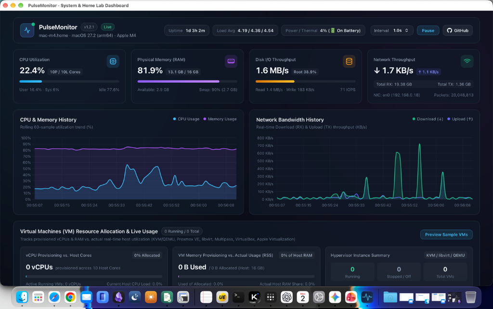

# ⚡ PulseMonitor

[](https://github.com/EJICDON/pulsemonitor/releases)
[](https://github.com/EJICDON/pulsemonitor)
[](https://github.com/EJICDON/pulsemonitor)

**PulseMonitor** is a lightweight, zero-lag, real-time system, workstation, and Home Lab monitoring dashboard built with **FastAPI**, **psutil**, **WebSockets**, and **Chart.js**.

Designed for **Ubuntu / Debian servers**, **Docker environments**, **VM clusters**, and **macOS workstations** (with a native Swift Menu Bar & Dock companion app), it provides an instant single-pane view of host hardware telemetry and Virtual Machine (VM) resource allocation versus actual utilization.



---

## ✨ Key Features

### 1. Real-Time Host Hardware Telemetry
- **Prominent Hostname & Multi-Node Identification**: Displays the active server/workstation **Hostname** directly in the top header badge, metadata bar, and browser tab title (`[hostname] PulseMonitor`) so you can easily distinguish multiple nodes (`pocser01`, `pocetac`, local workstation) across tabs.
- **Instant Chart Hydration + Live WebSockets**: Backed by an in-memory 120-second ring buffer (`/api/history`) so time-series charts render immediately on page load, followed by live `/ws/metrics` streaming (`0.5s`, `1.0s`, `2.0s`, or `5.0s` intervals with Pause/Resume).
- **4 Core KPI Cards & Historical Trends**:
  - **CPU Utilization**: Overall usage (`%`), physical & logical core counts, User / System / Idle breakdown, `1m / 5m / 15m` Load Averages, and Linux CPU package thermal sensor (`°C`) readings (`coretemp`, `k10temp`, `cpu_thermal`).
  - **Physical Memory (RAM & Swap)**: Used vs. total capacity, available memory, Swap usage, and visual allocation bar (`Wired/Buffers`, `Active`, `Cached/Inactive`, `Available`).
  - **Disk & Storage I/O**: Real-time read/write throughput (`KB/s` / `MB/s`), `IOPS`, and clean physical partition capacity bars (automatically filtering out Linux `snap`/`squashfs`, `overlay`, `tmpfs`, `/dev/loop*` and macOS synthetic volumes).
  - **Network Throughput**: Real-time Download (`↓`) and Upload (`↑`) bandwidth curves, cumulative RX/TX bytes, packet counts, and active IPv4 NIC badges.
- **Per-Core CPU Grid & Top Active Processes**:
  - Individual real-time utilization bars for every logical CPU core with color-coded load thresholds (`<60%` cyan, `60–85%` amber, `>85%` red).
  - Live **Top 8 Active Processes** sorted by CPU usage.

### 2. Virtual Machines (VM) Resource Allocation & Live Usage Monitoring
- **Multi-Hypervisor Auto-Discovery**:
  - Automatically detects VMs across **KVM / QEMU** (`qemu-system-*` process inspection for `-name`, `-smp` vCPUs, and `-m` allocated memory), **libvirt (`virsh`)**, **Proxmox VE (`qm list`)**, **Canonical Multipass**, **VirtualBox (`VBoxHeadless`)**, **VMware**, **Parallels**, and **Apple Virtualization.framework**.
- **Host vs. VM Provisioning Overview**:
  - **vCPU Provisioning vs. Host Cores**: Compares total allocated vCPUs against physical/logical host cores (including **Overcommit %** calculation) alongside actual host CPU load consumed by running VMs.
  - **VM Memory Provisioning vs. Actual Usage (RSS)**: Dual-layer progress bar comparing provisioned VM RAM, actual resident physical memory (`RSS`) consumed by running VMs, and unallocated host RAM headroom.
  - **Per-VM Live Telemetry Table**: Shows each VM's state (`Running` / `Stopped`), provisioned vCPUs & live guest load bar, actual used RSS vs. allocated memory bar, host CPU share, and uptime.
  - **Interactive Demo Preview Mode**: One-click **"Preview Sample VMs"** toggle to preview multi-VM Home Lab telemetry on workstations without active VMs.

### 3. Cross-Platform Packaging & Native Companion App
- **Ubuntu / Debian Native `.deb` Package**: Installs to `/opt/pulsemonitor`, configures an isolated Python virtual environment, registers the `pulsemonitor.service` `systemd` unit for automatic boot startup, and installs the `pulsemonitor` CLI tool.
- **Portable Linux Tarball Installer**: One-step `install_ubuntu.sh` and `uninstall_ubuntu.sh` scripts compatible with mainstream Linux distributions.
- **Docker & Docker Compose**: Pre-configured with `network_mode: host` and `pid: host` for accurate host-level telemetry.
- **Native macOS Menu Bar & Dock App (`PulseMonitor.app`)**: Written natively in Swift (`AppKit` + `WebKit`), displaying live `⚡ CPU% · RAM%` in the macOS top Menu Bar and launching a dedicated native desktop window from the Dock.

---

## 🚀 Installation & Quick Start

### Option 1: Ubuntu / Debian `.deb` Package (Recommended for Servers)

Download `pulsemonitor_1.2.2_all.deb` from **[GitHub Releases](https://github.com/EJICDON/pulsemonitor/releases)** (or build locally via `python3 linux/build_linux_packages.py`), then install:

```bash
sudo apt update
sudo apt install -y ./pulsemonitor_1.2.2_all.deb
```

Manage the service with the built-in CLI:

```bash
pulsemonitor status    # Check systemd service status & LAN URL
pulsemonitor logs      # Tail live service logs
pulsemonitor restart   # Restart service
pulsemonitor stop      # Stop service
pulsemonitor start     # Start service
pulsemonitor version   # Print installed version
```

---

### Option 2: Ubuntu / Linux One-Step Script Installer

```bash
tar -xzf dist/pulsemonitor-ubuntu-1.2.2.tar.gz
cd pulsemonitor
sudo bash linux/install_ubuntu.sh
```

To customize the listening port (default `8788`):

```bash
sudo PORT=9000 bash linux/install_ubuntu.sh
```

To uninstall completely:

```bash
sudo bash linux/uninstall_ubuntu.sh
```

---

### Option 3: Docker Compose

```bash
git clone https://github.com/EJICDON/pulsemonitor.git
cd pulsemonitor
docker compose up -d --build
```

---

### Option 4: Local Python / macOS Native Menu Bar App

Run the backend directly on macOS or Linux:

```bash
./run.sh
```

Build and launch the native macOS Menu Bar & Dock application (`PulseMonitor.app`):

```bash
./macos_app/build_app.sh
open PulseMonitor.app
```

Once running, open **`http://<server-ip>:8788`** (or `http://127.0.0.1:8788` locally) in any modern browser.

---

## 🔌 API Endpoints

| Endpoint | Method | Description |
| :--- | :--- | :--- |
| `/` | `GET` | Serves the real-time web dashboard UI |
| `/api/metrics` | `GET` | Returns the latest host + VM telemetry snapshot in JSON |
| `/api/history` | `GET` | Returns up to 120 seconds of buffered historical snapshots for instant chart hydration |
| `/ws/metrics` | `WS` | Streams live telemetry snapshots at configurable intervals (`0.5s` – `10.0s`) |

---

## 📁 Project Structure

```text
pulsemonitor/
├── app.py                        # FastAPI backend, psutil collectors & VM discovery engine
├── VERSION                       # Single-source semantic version file
├── requirements.txt              # Python dependencies (fastapi, uvicorn, psutil, websockets)
├── run.sh                        # Quick-start launcher script
├── Dockerfile                    # Container image definition
├── docker-compose.yml            # Host-mode Docker Compose configuration
├── static/
│   ├── index.html                # Dashboard layout & KPI / VM / Chart panels
│   ├── style.css                 # Dark glassmorphic UI stylesheet
│   └── app.js                    # WebSocket client, Chart.js controllers & VM renderer
├── linux/
│   ├── build_linux_packages.py   # Builds .deb package and portable .tar.gz in dist/
│   ├── install_ubuntu.sh         # One-step Ubuntu/Debian systemd installer
│   ├── uninstall_ubuntu.sh       # Clean uninstaller script
│   └── securecrt_deploy.py       # Automated deployment script for SecureCRT sessions
├── macos_app/
│   ├── PulseMonitorApp.swift     # Native macOS Menu Bar (NSStatusBar) & WKWebView app
│   └── build_app.sh              # Compiles and signs PulseMonitor.app with custom .icns icon
├── scripts/
│   └── release.sh                # Semantic version bump, package builder & Git tagging script
└── .github/workflows/
    └── release.yml               # GitHub Actions CI & automated GitHub Release publisher
```

---

## 🏷️ Version Control & Releasing

To bump the version, rebuild Linux `.deb` and `.tar.gz` artifacts, commit, and create an annotated Git tag:

```bash
./scripts/release.sh 1.2.2 "Display prominent hostname badge and update documentation"
git push origin main --follow-tags
```

Pushing a `v*.*.*` tag triggers the GitHub Actions workflow (`.github/workflows/release.yml`), which automatically builds and attaches `pulsemonitor_<version>_all.deb` and `pulsemonitor-ubuntu-<version>.tar.gz` to a new **GitHub Release**.

---

## 📄 Copyright & License

Copyright © 2026 **EJICDON**. Released under the **MIT License**.  
🔗 Repository: [https://github.com/EJICDON/pulsemonitor](https://github.com/EJICDON/pulsemonitor)
